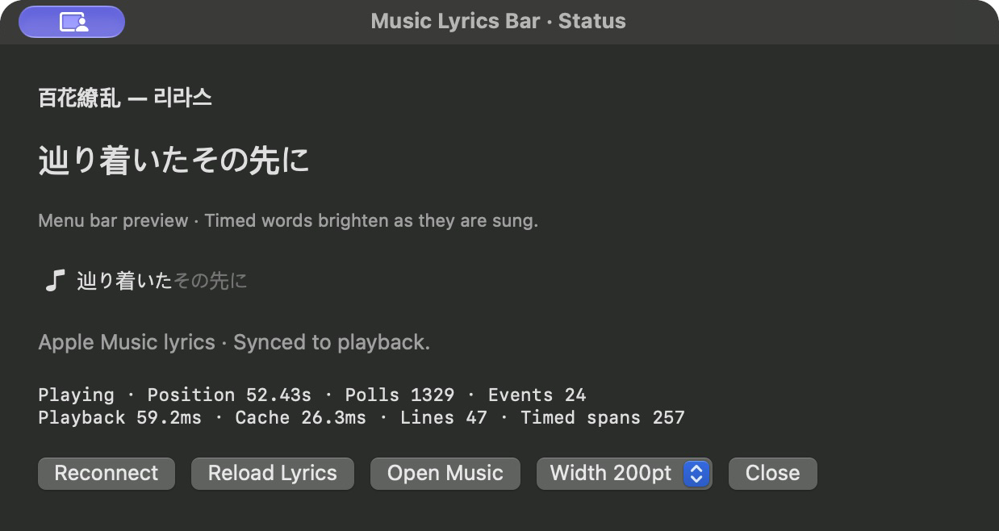

<div align="center">

# ♪ Music Lyrics Bar

**Apple Music lyrics. Right in your menu bar.**

Original lyrics, live word highlighting, and a little less window switching.

[](https://github.com/mytrashcan/applemusic-menubar-lyrics/actions/workflows/ci.yml)
[](#getting-started)
[](#build-from-source)
[](LICENSE)

[**Download**](https://github.com/mytrashcan/applemusic-menubar-lyrics/releases/latest) · [**Get started**](#getting-started) · [**Join the conversation**](https://github.com/mytrashcan/applemusic-menubar-lyrics/discussions)

<br>


**Follow every word, without opening another window.**

<sub>8 seconds of actual playback · [Static image](docs/images/menu-bar.png) · [Capture details](docs/images/README.md)</sub>

</div>

<br>

| Original lyrics | In time with the music | Native and local |
| :--- | :--- | :--- |
| Uses the lyrics Music has already downloaded. | Sung words brighten; upcoming words stay dim. | Built with Swift and AppKit. No external lyrics service. |

> **Early project.** Lyrics come from Apple Music's private local cache, which may change with macOS updates. The app is ad-hoc signed for local use and is not notarized.

## In action

Long lines scroll with the sung portion. Pause, seek, or change tracks, and the
menu bar follows playback. Between lines, the previous lyric stays visible.
Word highlighting uses Apple's word or syllable timestamps when available;
other sources use line-level display.

<details>
<summary><strong>See the status window</strong> — live preview and playback diagnostics</summary>

<br>



The preview shares the menu bar's rendered image. Close this window to keep just
the menu bar running. [Screenshot provenance](docs/images/README.md).

</details>

## Getting started

Choose the [latest release](https://github.com/mytrashcan/applemusic-menubar-lyrics/releases/latest)
or [build from source](#build-from-source) for the current implementation.
Packaged releases may trail `main`; check the release's architecture and notes.

| Step | What to do |
| :---: | :--- |
| **1** | Open the app and choose **Connect to Music…**. Allow Music automation when macOS prompts. |
| **2** | Play a song in Music and **open its lyrics panel once** so Music can cache the lyrics. |
| **3** | Let the app retry, or choose **Reload Lyrics Cache**. Your lyrics appear when a matching cache entry is available. |

The app remembers your connection choice. Turn off **Connect on Launch** in its
menu if you prefer to connect manually.

### Build from source

Requires **macOS 13+** and **Swift 6+** from Xcode or Command Line Tools.

```sh
git clone https://github.com/mytrashcan/applemusic-menubar-lyrics.git
cd applemusic-menubar-lyrics
bash scripts/test.sh
bash scripts/build-app.sh
open "dist/Music Lyrics Bar.app"
```

Outputs: `dist/Music Lyrics Bar.app` and `dist/MusicLyricsBar.zip`.
GitHub Actions also tests and packages the app.

## Make room for your lyrics

Choose **Lyrics Width**: **200** · **240** · **360** · **600pt**. The default is 200pt.
The width stays fixed as lines change; long lyrics scroll instead of becoming an
ellipsis. Full text is also available in the tooltip and status window.

**Item hidden?** Try 200pt, expand the native overflow area, then hold **⌘** and
drag the lyric item toward the right. macOS still controls available menu bar space.

<details>
<summary>More about overflow, placement, and Reduce Motion</summary>

Choose **Lyrics Width** in the menu or the width control in the status window: 200, 240, 360, or 600pt. The default is 200pt. The selected width stays fixed across lyric changes, and overflowing text scrolls instead of being replaced with an ellipsis. With the system’s Reduce Motion setting enabled, automatic ticker motion is disabled. Full lyrics remain available in the tooltip and status window.

The app uses a standard macOS status item. On macOS 27.2, the native `<<` overflow button can expand hidden items into the left region. This expansion can collapse again and does not provide permanent left placement.

If lyrics are hidden, select **200pt**, expand the native overflow area, then **hold ⌘ and drag the lyric item to the right**. In local observations, right-side placement kept lyrics visible after collapsing overflow and restarting the app. Reducing width alone did not solve hiding. Items may still be hidden when space is insufficient. Width preferences persist across launches. There is no separate fixed overlay.

</details>

## Quiet in the background

Display updates stop while paused or disconnected and wait for the next relevant
boundary between timed words. Cached text images keep redraw work small, and
subsequent launches can connect without opening the status window.

[Read the measured CPU and memory results →](docs/PERFORMANCE.md)

<details>
<summary>Measurement method and implementation details</summary>

The display timer stops while paused or disconnected and sleeps until the next relevant boundary between timed words. Static text does not trigger continuous redraws. The menu bar and status preview share one cached image; text is rasterized once per lyric change. Closing the status window releases its controller and views. Subsequent launches can connect without constructing the status window.

Music playback notifications trigger immediate reads, with periodic fallbacks to recover from missed notifications. Cache reads remain independent, and cancelled requests stop before queued work proceeds. JSON payloads are released between cache rows rather than accumulating during a scan.

Measure CPU time and physical memory footprint locally with the standard-library helper:

```sh
python3 scripts/measure-process.py <PID> --seconds 60
```

The helper reports CPU as a percentage of one core and physical footprint separately from RSS. Shared resident framework pages mean RSS is not the same as the app’s physical memory footprint. Playback, pauses, and visible diagnostic windows should be measured separately.

See [measured results and limitations](docs/PERFORMANCE.md) for playback, pause, and cold-launch observations.

</details>

## Your music stays on your Mac

**No network requests. No external lyrics service. No saved listening history.**

The app reads the current track and playback position through Music automation,
then opens the local lyrics cache **read-only**. It does not read account tokens,
request headers, or the Music library database. Accessibility and Screen Recording
permissions are not required.

<details>
<summary>Data flow, cache paths, and architecture</summary>

```text
Music.app ── Apple Events ── Current track / playback position
                                             │
Local Music cache ── Read-only ── Track matching → TTML parsing
                                             │
                                      Menu bar display
```

Cache locations:

```text
~/Library/Caches/com.apple.Music/Cache.db
~/Library/Caches/com.apple.Music/fsCachedData/
```

The app makes no network requests. It opens the cache database read-only and does not read account tokens, request headers, or the Music library database. It does not save or transmit lyrics or listening history. Accessibility and Screen Recording permissions are not required.

`LyricsCore` contains lyric models, the Apple TTML parser, the playback clock, and SQLite cache access. `MusicLyricsBar` performs Apple Events and cache reads in serial actors and updates the AppKit UI on the main thread. There are no third-party package dependencies.

</details>

## Before you try it

- Open lyrics in Music first: this app uses already cached lyrics and does not fetch them from an API.
- Word shading depends on the timing data available for that recording.
- Initial cache access can be slow; playback polling continues independently.
- A crowded menu bar can still hide the item.
- Launch at login, translation, pronunciation, and a notarized installer are not provided.

<details>
<summary>All current limitations</summary>

- Lyrics must already be downloaded by Music. The app does not request lyrics from an API.
- At most 512 recent lyrics-related cache responses are scanned. Reopen lyrics in Music if only older cache entries remain.
- Metadata differences or unsupported cache formats may prevent matching. The app does not substitute lyrics from a guessed track.
- Word highlighting requires word or syllable timestamps. Sources without them use line-level display. Translation and pronunciation display are not implemented.
- Progress within a multi-character span is interpolated; Apple does not necessarily provide a timestamp for each character.
- Initial cache reads have taken tens of seconds in local observations. Playback polling continues independently while lyrics load.
- After the first connection, subsequent launches connect in the background unless **Connect on Launch** is disabled. Launch at login and a notarized installer are not provided. The width preference is saved.
- The Music cache is not a public API. App Store distribution has not been evaluated.

</details>

## Build it with us

Try it on your Mac, share a workflow, or pick a small contribution.

| Get involved | Start here |
| :--- | :--- |
| Ask a question | [Setup and usage Q&A](https://github.com/mytrashcan/applemusic-menubar-lyrics/discussions/categories/q-a) |
| Help test | [Compatibility and playback checklist](https://github.com/mytrashcan/applemusic-menubar-lyrics/discussions/5) |
| Share an idea | [Ideas and proposals](https://github.com/mytrashcan/applemusic-menubar-lyrics/discussions/categories/ideas) |
| Report a bug | [Open an issue](https://github.com/mytrashcan/applemusic-menubar-lyrics/issues/new/choose) |
| Make your first PR | [Good first issues](https://github.com/mytrashcan/applemusic-menubar-lyrics/issues?q=is%3Aissue%20is%3Aopen%20label%3A%22good%20first%20issue%22) · [Contributing guide](CONTRIBUTING.md) |

[Introduce yourself →](https://github.com/mytrashcan/applemusic-menubar-lyrics/discussions/4)
English and Korean are welcome in community conversations. Project documentation
and PRs use English. Please follow the [community guidelines](CODE_OF_CONDUCT.md).
When reporting problems, share cropped UI and relevant metrics; do not upload Music
caches, account data, complete lyrics, or listening-history exports.

<details>
<summary><strong>Developer notes</strong> — tests and live playback validation</summary>

```sh
# Deterministic tests with synthetic lyrics and temporary SQLite databases
bash scripts/test.sh

# Optional: verify parsing and matching against this Mac’s Music cache
MUSIC_LYRICS_CACHE_INTEGRATION=1 bash scripts/test.sh
```

Tests cover time formats, timed spans and line breaks, Unicode and entity ranges, word progress, gap retention, metadata exclusion, malformed XML, overlapping lyrics, pauses and backward seeks, cache-miss retries, recording mismatches, read-only cache access, and file-path checks. Native Apple Event object references, reply decoding, and automation denial handling are tested without contacting Music. Repository fixtures contain only synthetic text. The optional local integration test does not print lyrics or track titles.

Local playback checks confirmed lyric agreement, stable paused positions, forward and backward seeks, track changes, and continued updates with Music hidden. A source with 513 timed spans showed bright sung text and dim upcoming words. These observations are not a millisecond-level sound-to-screen latency benchmark. Further manual checks include:

- Comparing the menu bar line with Music’s highlighted lyric during playback.
- Pausing, seeking in both directions, and changing tracks.
- Hiding or minimizing Music after its lyrics are cached.
- Denying automation permission and reconnecting afterward.

See the [local validation report](docs/VALIDATION.md) for observations and remaining limits.

</details>

## Acknowledgments

Prior local-cache projects: [apple-music-lyrics](https://github.com/Takpap/apple-music-lyrics) and [applyrx](https://github.com/rakei076/applyrx). This implementation is based on cache structures inspected locally.

This is an unofficial project, unaffiliated with Apple. Lyrics and related content belong to their respective rights holders.

---

<div align="center">

[WTFPL v2](LICENSE) · Copyright © 2026 JEONG KITAE

<sub>Unofficial. Not affiliated with Apple. Lyrics and Apple-related content belong to their respective rights holders and are not covered by this software's WTFPL license.</sub>

</div>
